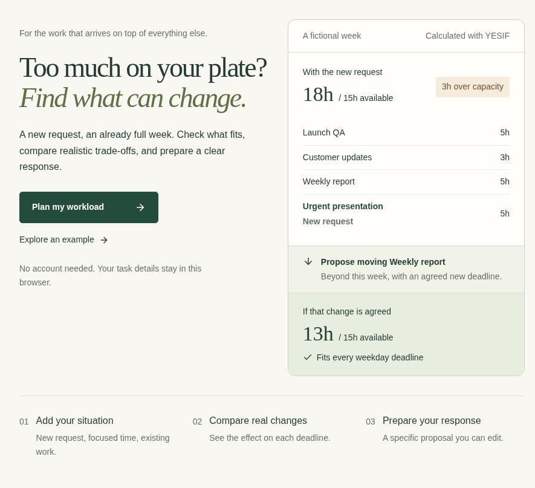
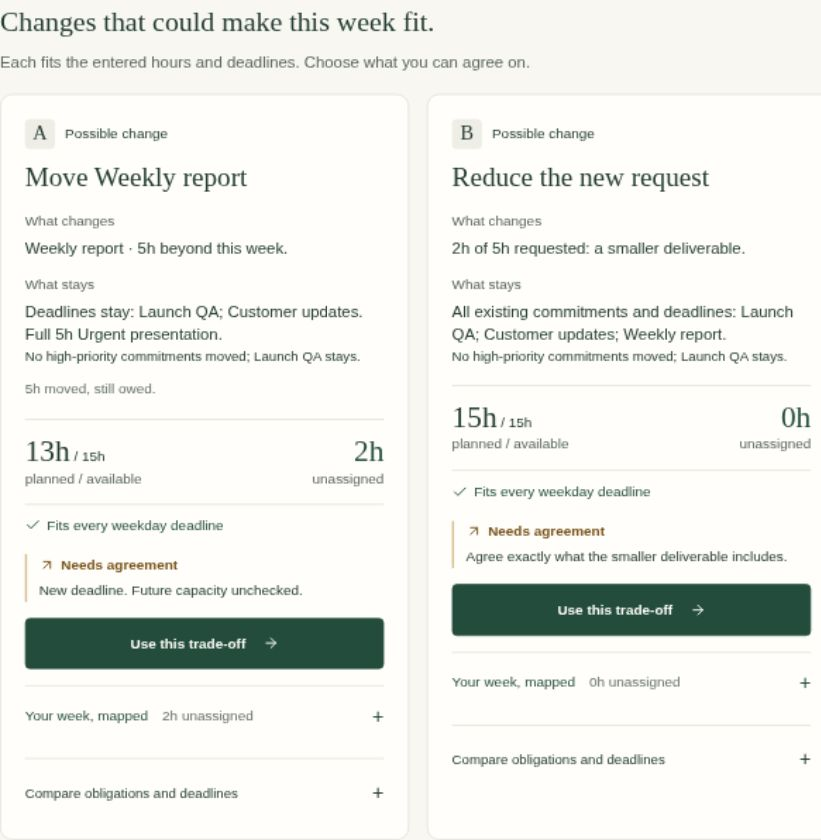
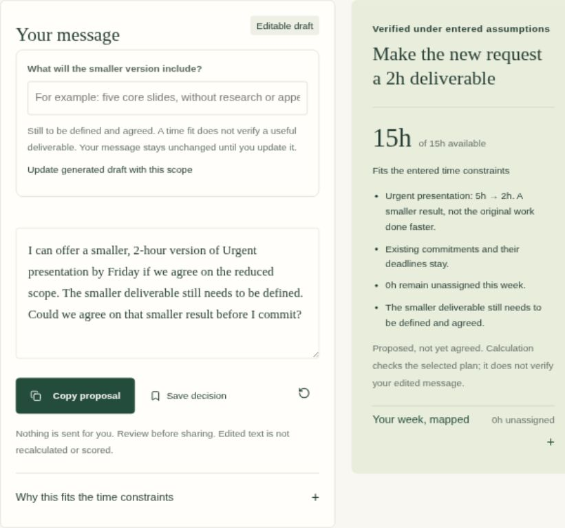

# YESIF

**Every yes needs an if.**

**Know what must change before you agree to more work.** YESIF is a private, browser-based tool for checking workload commitments, comparing trade-offs, and preparing a clear conversation about priorities.

[**Open YESIF**](https://pandaman-8.github.io/yesif/) · [**View the source**](https://github.com/Pandaman-8/yesif)



## The problem

A new request can look reasonable in isolation and still collide with earlier deadlines. A weekly total alone cannot show whether work due Tuesday can actually fit by Tuesday. Saying *yes* without naming the change needed often turns a planning problem into a difficult conversation.

The initial audience hypothesis is individual US project and marketing coordinators who can discuss new requests with a manager or client. YESIF is B2C-oriented; this customer focus remains unvalidated.

## How it works

1. **Describe the request.** Enter its remaining effort and weekday deadline alongside existing commitments, negotiability, priority, daily focused capacity, and optional reserve.
2. **Check the constraints.** YESIF calculates cumulative deadlines across Monday–Friday, not just total weekly hours, and distinguishes existing conflicts from pressure introduced by the new request.
3. **Compare grounded changes.** Examine whether moving a *negotiable* commitment, reducing the new deliverable, or combining changes would fit. Fixed commitments cannot be moved automatically.
4. **Prepare the conversation.** Choose a checked plan, inspect what remains owed and what needs approval, then edit and copy a conditional message.
5. **Practice and return.** Rehearse a short two-step objection, record the outcome, reuse a saved decision, and prepare a follow-up.



## A calculated example

The included fictional example has **13h of existing work**, a **5h presentation request**, and **15h of usable weekly capacity**.

| Choice | Planned this week | What changes |
| --- | ---: | --- |
| Keep everything | **18h / 15h** | Not feasible under the entered estimates |
| Move a negotiable 5h report | **13h / 15h** | Report remains owed; a new deadline needs agreement and future capacity is unchecked |
| Reduce the request to a 2h deliverable | **15h / 15h** | Smaller deliverable and its contents need agreement; 0h unassigned |

All figures come from the same deterministic calculation used for custom workloads. Changing inputs recomputes the results. The tool never claims that a proposed change has already been approved.

More product views: [negotiation practice](screenshots/04-practice.jpg), [Notebook](screenshots/05-notebook.jpg), [saved comparison](screenshots/06-saved-comparison.jpg), and [Decision Brief](screenshots/07-decision-brief.jpg). [Gallery and capture provenance](screenshots/README.md).

## Core features

- Deadline-aware feasibility with quarter-hour precision, daily usable capacity, and explicit reserve.
- Task-level alternatives, manual simulation of combined changes, and day-by-day allocation details.
- Conditional messages that can be edited and copied without automatic sending.
- An optional **two-decision negotiation rehearsal** with authored responses and explanation of five criteria. It is **not AI grading** and does not measure skill improvement.
- Local draft recovery, save/discard/cancel guards, and a browser-local decision notebook.
- A clearly labeled **Negotiation Kit demo**: saved-decision comparison, preparation playbook, editable follow-ups, and copyable/printable decision briefs.



## Free and Kit demo

**Free:** unlimited checks, alternatives and current-plan comparisons, proposal editing/copying, negotiation practice, and one locally saved decision.

**Kit demo:** additional locally saved decisions (up to 50), saved-snapshot comparison, playbook, follow-ups, and decision briefs. Unlocking the demo is **free and lasts for the current visit**; existing saved records remain readable and exportable afterward.

**$4.99 one-time is a proposed, unvalidated price.** There is no payment processing, subscription, account, or automatic charge. No user demand, conversion, retention or willingness to pay is claimed.

## Privacy and limitations

YESIF requires **no account**, backend, external AI service, analytics, or third-party calendar access. Task names, messages, and decisions are entered and stored in the current browser; they are not synchronized across devices. Use export when you need a backup. Clearing browser data can remove saved work.

The model covers **one person, five weekdays, and up to eight existing commitments**. Estimates are divisible, have no dependencies, and are assumed available from the start of the week. It does not verify real calendar availability, quality of a reduced deliverable, another person's approval, or capacity in a later week. **A mathematical fit is not a delivery guarantee.**

## Run locally

Requirements: Node.js 22.22+ and npm.

```bash
npm ci
npm run dev
```

Open the URL printed by Vite, normally with the `/yesif/` path. For release checks:

```bash
npm run typecheck
npm test
npm run build
git diff --check
```

The application is built with **React, TypeScript and Vite**. Domain calculations are deterministic, and tests include randomized verification of feasibility, allocation, and causal explanations. AI-assisted coding tools were used in development; their use does not replace the application’s verified calculation logic.

## Project evidence

- [Product and technical decision records](docs/PRODUCT_DECISION.md)
- [Calculation specification](docs/V2_ENGINE_SPEC.md)
- [V2.5.1 release QA](docs/FINAL_RELEASE_V2_5_1_QA.md) — 153 passing tests, captain-confirmed two-page print QA, verified production assets
- [Release v2.5.1](https://github.com/Pandaman-8/yesif/releases/tag/v2.5.1) · [release CI](https://github.com/Pandaman-8/yesif/actions/runs/43653504693)
- [Final engineering handoff](docs/FINAL_HANDOFF.md) · [Pitch handoff and draft corrections](docs/FINAL_PITCH_HANDOFF.md)
- [Production website](https://pandaman-8.github.io/yesif/)

**Business Cup 2.0 · Skills track.** The initial customer, pricing, differentiation and retention are hypotheses to validate, not measured commercial results.
